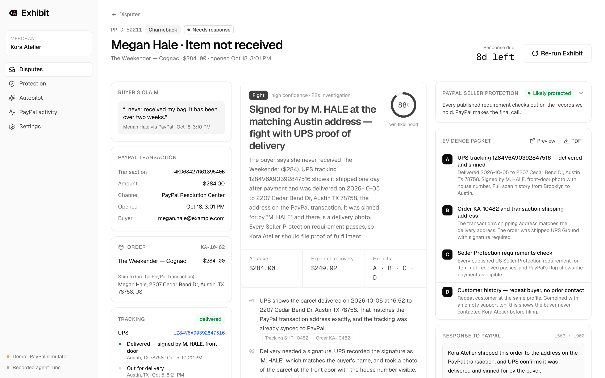

# Exhibit

**The AI dispute agent for PayPal merchants.** Exhibit investigates every PayPal dispute the moment it opens, decides whether to fight, offer, refund or message the buyer, builds an evidence packet from the merchant's own records, and files the response through the PayPal API. When a case can't be won, it says so and refunds instead.

Built for the [PayPal AI Hackathon 2026](https://paypalaihackathon.devpost.com/).



## Run it in two minutes (no keys needed)

```bash
npm install
npm run dev
```

Open http://localhost:3000. That's it:

- **PayPal:** with no credentials, Exhibit runs against a built-in PayPal simulator that implements the Disputes v1, Orders v2 and Payments v2 endpoints it uses, with PayPal's request and response shapes, errors and limits. The same HTTP client code path talks to the real sandbox when you add credentials.
- **AI:** with no model key, Exhibit replays recorded agent runs. The reasoning is replayed, but every tool call executes live against the current case, and the recorded brief must pass the same validation as a live one. Add `ANTHROPIC_API_KEY` to run the agent live.

Try this path:

1. **Disputes** shows the demo merchant's 8 open cases, each with Exhibit's call.
2. Open **Megan Hale · Item not received**, click **Run Exhibit**, and watch the investigation stream in.
3. Open the evidence packet (**Preview**), then **File evidence with PayPal**.
4. In **Simulator controls**, click **Rule for merchant**. The case is won.
5. Back on **Disputes**, click **Simulate new dispute**. A `CUSTOMER.DISPUTE.CREATED` event arrives and Exhibit starts on its own.
6. **Protection** pushes missing tracking numbers to PayPal. **Autopilot** previews what Exhibit would do on its own under your rules. **PayPal activity** lists every API call.

The pitch deck is at http://localhost:3000/pitch (arrow keys to navigate).

## Use your PayPal sandbox

1. At [developer.paypal.com](https://developer.paypal.com/) → **Apps & Credentials** (Sandbox), create a **Merchant** app. Customer disputes are enabled by default under *Features → Add-on services*.
2. Copy `.env.example` to `.env.local` and set `PAYPAL_CLIENT_ID` and `PAYPAL_CLIENT_SECRET` (and `EXHIBIT_APP_URL` if you don't run on port 3000).
3. Restart. The sidebar shows **PayPal Sandbox · live API**; **Settings → Test connection** checks OAuth and the Disputes API.
4. **Settings → Seed the sandbox** creates real disputes in three steps:
   - **Create sandbox orders** makes one Orders v2 order per demo scenario. If your sandbox business account has advanced card processing, the order is paid with a test card and captured at once. Most new accounts don't (`PAYEE_NOT_ENABLED_FOR_CARD_PROCESSING`), so the order waits for a buyer instead.
   - **Open PayPal checkout as the buyer** for each waiting order, in a private window. Choose *Pay with Debit or Credit Card*, use a [sandbox test card](https://developer.paypal.com/tools/sandbox/card-testing/), and turn on *Save info & create your PayPal account* (guest-only payments were declined in our tests). The sandbox SMS code is `111111`. Sign out of PayPal between buyers so each case gets its own buyer.
   - **Capture approved & open chargebacks** captures each approved order, opens a chargeback with the sandbox-only `process-chargeback` endpoint, and writes the matching store records so the agent can investigate.
5. New chargebacks start `OPEN`, move to **PayPal reviewing** (only `provide-supporting-info` is open), and a few minutes later to **Needs response** with `provide-evidence` and `accept-claim`. Exhibit answers whichever PayPal allows: evidence while PayPal is waiting on the seller, supporting info (letter + PDF packet) while it is reviewing. Sandbox `adjudicate` is accepted on chargebacks but PayPal resolves them asynchronously.
6. For webhooks, expose the app (for example with a tunnel), add `https://<host>/api/webhooks/paypal` to the app's sandbox webhooks with the `CUSTOMER.DISPUTE.*` events, and set `PAYPAL_WEBHOOK_ID`. Signatures are verified with PayPal's `verify-webhook-signature` API.

### Verified against the live sandbox (2026-10-20)

OAuth client credentials · Orders v2 create (card and PayPal checkout) and capture · Payments v2 capture lookup, including PayPal's `seller_protection` flag (`ELIGIBLE` for item-not-received and unauthorized) · `process-chargeback` · Disputes list/get · `provide-evidence` (multipart: one `PROOF_OF_FULFILLMENT` with UPS tracking, the agent's letter and the PDF packet) · `provide-supporting-info` (letter + PDF) · `adjudicate`. Lessons now encoded in the client and simulator: file only the evidence types PayPal requested, send one evidence per call (a multi-evidence payload with a tracking URL returned a sandbox 500), and include `item_id` when sending several.

## What the agent does

Exhibit runs a tool-using agent on Claude (`claude-opus-5-5`, adaptive thinking) with nine tools:

| Tool | Source |
| --- | --- |
| `get_paypal_dispute` | PayPal Disputes API: reason, stage, deadline, buyer messages, requested evidence, **allowed actions** |
| `lookup_order` | Store order joined by capture id / invoice number, with the exact listing text |
| `get_carrier_tracking` | Scans, delivery date, signature, photos, address match against the PayPal transaction |
| `get_customer_history` | Orders, lifetime value, prior disputes |
| `get_support_conversation` | Email and chat with the buyer |
| `get_payment_risk_signals` | AVS, CVV, 3-D Secure, IP and device |
| `get_store_policies` | Returns, shipping and terms as accepted at checkout |
| `check_seller_protection` | Deterministic check against PayPal's published US Seller Protection requirements, quoted verbatim |
| `file_case_brief` | The structured deliverable: decision, win likelihood, reasoning, exhibits, PayPal action, response letter, buyer message |

### Guardrails

- **Cites, never invents.** Every tool result carries evidence refs (`shipment:SHP-10482`, `policy:returns`). The brief may only cite refs that resolve, and the PDF packet re-reads each ref from source records. The model chooses and explains evidence; it cannot write it.
- **Only actions PayPal allows.** `file_case_brief` is rejected unless the action matches the dispute's current HATEOAS links and allowed offer types, and amounts are within the disputed amount. The model fixes and refiles.
- **Honest outcomes.** The playbook tells the agent to refund or offer when the merchant is at fault: a returned-to-sender parcel gets a refund, a return that arrived gets "refund now, then file proof of refund".
- **Autopilot with limits.** Off by default. Per-decision amount and likelihood thresholds; low-confidence briefs always go to a person; every action is audit-logged.
- **Prompt-injection hygiene.** Buyer messages and tool results are treated as data, never instructions.

## PayPal APIs used

| Endpoint | Used for |
| --- | --- |
| `POST /v1/oauth2/token` | Client-credentials OAuth |
| `GET /v1/customer/disputes`, `GET /v1/customer/disputes/{id}` | Inbox sync, live case facts |
| `POST /v1/customer/disputes/{id}/provide-evidence` | Evidence types + tracking info + PDF packet (multipart) |
| `POST /v1/customer/disputes/{id}/provide-supporting-info` | Letter + PDF packet for chargebacks PayPal is already reviewing |
| `GET /v2/payments/captures/{id}` | PayPal's own Seller Protection flag for the payment |
| `POST /v1/customer/disputes/{id}/make-offer` | Refunds, returns, replacements |
| `POST /v1/customer/disputes/{id}/accept-claim` | Honest refunds |
| `POST /v1/customer/disputes/{id}/send-message` | Inquiry-stage buyer messages |
| `POST /v2/payments/captures/{id}/refund` | Refund-then-prove for credit-not-processed |
| `POST /v2/checkout/orders/{id}/track` | Tracking sync (Protection) |
| `POST /v1/notifications/verify-webhook-signature` | Webhook verification |
| `POST /v2/checkout/orders`, `…/capture`, `POST /v2/customer-support/process-chargeback` | Sandbox seeding |
| `POST /v1/customer/disputes/{id}/adjudicate`, `…/require-evidence` | Sandbox lifecycle controls |

## Architecture

```
src/
  app/                    Next.js 16 App Router: landing (/), pitch (/pitch), app (/app/*), API routes
  lib/paypal/client.ts    PayPal REST client (OAuth, Disputes, Orders, Payments, Webhooks), logs every call
  lib/paypal/simulator.ts PayPal API simulator behind the same fetch() interface (demo mode)
  lib/agent/              Tools, prompt, brief schema, playbook + Seller Protection checks, providers
    providers/anthropic.ts    Claude API: streaming tool loop, adaptive thinking, refusal fallback
    providers/claude-code.ts  Development: same tools through the Claude Agent SDK on a local login
    providers/replay.ts       Offline: replays recorded runs, executes tools live, re-validates the brief
  lib/actions.ts          Executes the brief's PayPal action; sandbox controls; tracking sync
  lib/packet/             Evidence packet PDF (react-pdf), rendered from evidence refs
  lib/store/              Demo merchant (Kora Atelier): orders, shipments, customers, messages, risk, policies
  components/             UI: AG Grid inbox and protection tables, case workspace, deck
replays/                  Recorded agent runs used when no model key is configured
docs/                     Submission copy, demo script, research, PayPal source snapshots
```

Data lives in SQLite (`node:sqlite`, one file per mode) under `.data/`.

## Environment

| Variable | Purpose |
| --- | --- |
| `PAYPAL_CLIENT_ID`, `PAYPAL_CLIENT_SECRET` | Sandbox REST app credentials. Without them, demo mode. |
| `PAYPAL_WEBHOOK_ID` | Webhook signature verification (sandbox) |
| `ANTHROPIC_API_KEY` | Run the agent live on the Claude API |
| `EXHIBIT_MODEL` | Override the model (default `claude-opus-5-5`) |
| `EXHIBIT_APP_URL` | Public URL, shown as the webhook listener |
| `EXHIBIT_ALLOW_CLAUDE_CODE=1` | Development: run the agent on a local Claude Code login |
| `EXHIBIT_RECORD_REPLAYS=1` | Development: save live runs to `replays/` |

## Notes on data and claims

- Kora Atelier, its customers and orders are fictional demo data. Carrier events are recorded data, not live carrier API calls.
- Seller Protection requirements are quoted from PayPal's US program page, retrieved 2026-10-20 (`docs/sources/`). PayPal makes every decision; Exhibit prepares the response.
- Market figures in the deck: Mastercard & Datos Insights (2025 chargeback projections) and PayPal's FY2025 Form 10-K.

## License

MIT. Fonts: Inter, Instrument Serif and JetBrains Mono under the SIL Open Font License.
